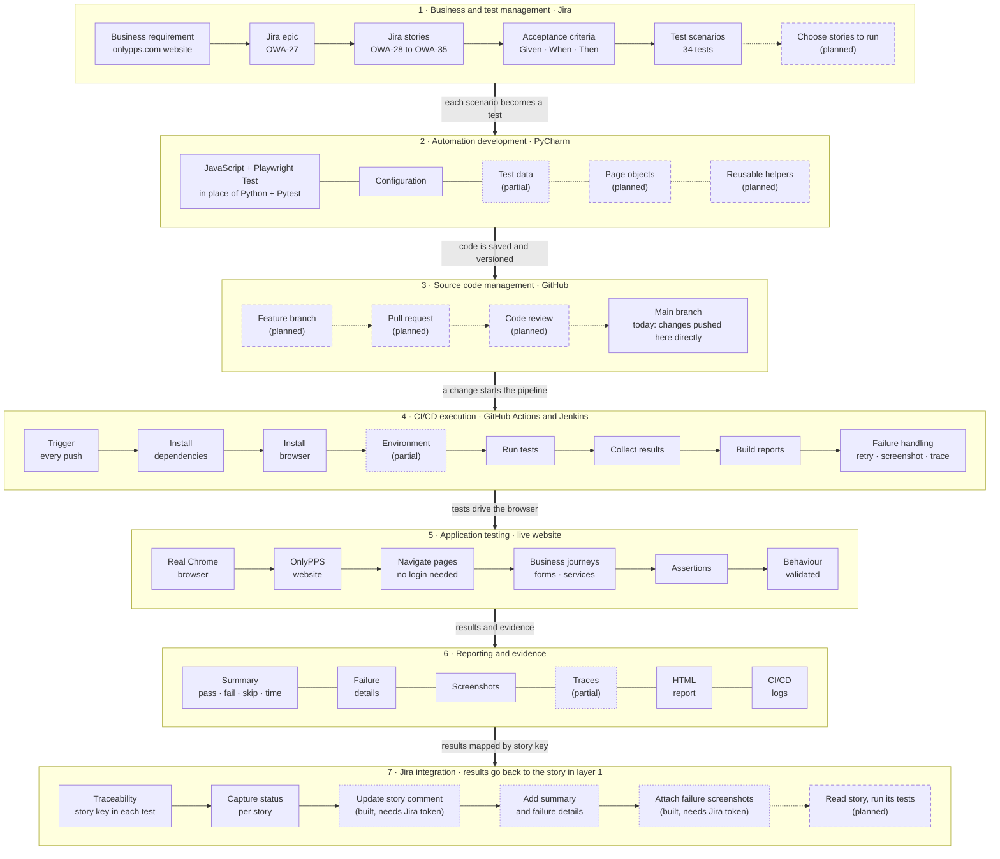

# Automation Architecture

How the onlypps.com test automation works end to end, from a business need written in Jira to proof that the website behaves as expected.

Read the diagram from top to bottom. A business need becomes a Jira story, the story becomes automated tests, the tests are stored in GitHub, the pipeline runs them against the live website, and the results flow into reports and back to the same Jira story.

**Key:** solid border = in place today · dotted border = partly in place · dashed border = planned

## The seven layers

| # | Layer | What it does | In place today | Partial or planned |
|---|---|---|---|---|
| 1 | Business and test management | The need is written in Jira as epic OWA-27 with 8 stories and acceptance criteria. | Epic, stories, criteria, 34 scenarios | Choosing which stories to run (planned) |
| 2 | Automation development | Scenarios become Playwright tests, written in PyCharm. | JavaScript + Playwright Test, `playwright.config.js` | Test data lives inside test files (partial); page objects and helpers (planned) |
| 3 | Source code management | All test code is versioned in GitHub. | Repository, `main` branch | Feature branch, pull request, code review (planned) |
| 4 | CI/CD execution | Every push starts a clean run: install, run, collect, report. | GitHub Actions and Jenkins, retries and failure evidence | Environments: production only (partial) |
| 5 | Application testing | A real Chrome browser uses the live site as a visitor would. | Navigation, business journeys, assertions | Login: not applicable on the public site |
| 6 | Reporting and evidence | Each run leaves a summary, failure details, screenshots, an HTML report and logs. | Summary, failures, screenshots, HTML report, CI logs | Traces only on CI retries (partial) |
| 7 | Jira integration | Results are matched to stories by the key in each test name, and the pipeline posts them to each story. | Traceability, status per story key, `scripts/jira-report.js` in GitHub Actions | Story comment and failure screenshots are built but run as a dry run until the Jira secrets are added (partial); reading a story and running only its tests (planned) |

## Notes

- The framework is JavaScript (`@playwright/test`). Python and Pytest were considered, and the decision was to stay on JavaScript.
- Each test title starts with its Jira story key, for example `OWA-31: fills the contact form with sample data`. That key is the link between a test result and its story.
- The contact form is filled but never submitted; requests that would send it are blocked.
