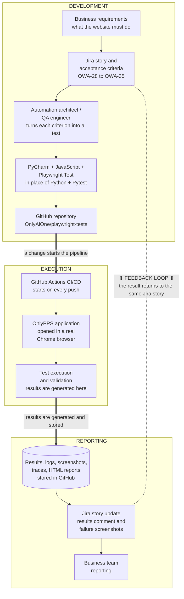

# Automation Architecture Document

OnlyPPS website test automation · repository `OnlyAiOne/playwright-tests` · last reviewed 6 November 2026

Status words used throughout: **Implemented** means it exists in the repository or the connected services today. **Recommended** means it is proposed and not built.

## 1. Objective

Check the key journeys of the live website [onlypps.com](https://onlypps.com/) automatically on every change, keep evidence of each run, and record each result on the Jira story whose acceptance criteria it proves.

## 2. Scope

**In scope**

- 23 public pages of onlypps.com: home, contact, about, the Services page and its 14 service pages, Industries, and the four Resources pages (Blog, HR Guides, HR Compliance Checklist, FAQ).
- 34 Playwright tests covering 8 Jira stories, `OWA-28` to `OWA-35`, under epic `OWA-27`.
- Running in Chromium on GitHub Actions (every push and pull request to `main`) and on a local Jenkins.
- Posting results to the Jira stories.

**Out of scope**

- Sending real enquiries. The contact form is filled but its submission is blocked.
- Logins, back-end systems, performance and load testing. The public site has no login.
- Browsers other than Chromium, and any environment other than the live site.
- The Cypress tutorial examples and Python practice scripts that share this repository. CI does not run them.

## 3. Architecture

### Business view

What happens, in which order, grouped into development, execution and reporting. The dotted line is the feedback loop: every result returns to the Jira story it came from.

### Technical view

The real components in each of the seven layers. Arrows marked "generates" show where results are created; cylinders show where results are stored, and dashed cylinders are temporary (deleted when the CI runner ends, or overwritten on the next local run).

Planned items (pull requests and code review, page objects, choosing which stories to run) are not drawn. Their status is in the table below.

### The seven layers

| # | Layer | What it does | In place today | Partial or planned |
|---|---|---|---|---|
| 1 | Business and test management | The need is written in Jira as epic OWA-27 with 8 stories and acceptance criteria. | Epic, stories, criteria, 34 scenarios | Choosing which stories to run (planned) |
| 2 | Automation development | Scenarios become Playwright tests, written in PyCharm. | JavaScript + Playwright Test, `playwright.config.js` | Test data lives inside test files (partial); page objects and helpers (planned) |
| 3 | Source code management | All test code is versioned in GitHub. | Repository, `main` branch | Feature branch, pull request, code review (planned) |
| 4 | CI/CD execution | Every push starts a clean run: install, run, collect, report. | GitHub Actions and Jenkins, retries and failure evidence | Environments: production only (partial) |
| 5 | Application testing | A real Chrome browser uses the live site as a visitor would. | Navigation, business journeys, assertions | Login: not applicable on the public site |
| 6 | Reporting and evidence | Each run leaves a summary, failure details, screenshots, an HTML report and logs. | Summary, failures, screenshots, HTML report, CI logs | Traces only on CI retries (partial) |
| 7 | Jira integration | Results are matched to stories by the key in each test name, and the pipeline posts them to each story. | Traceability, status per story key, `scripts/jira-report.js` in GitHub Actions | Story comment and failure screenshots are built but run as a dry run until the Jira secrets are added (partial); reading a story and running only its tests (planned) |

## 4. Component descriptions

| Component | Location | What it does | Status |
|---|---|---|---|
| Test framework | `@playwright/test` 1.64.1 in `package.json` | Runs the tests in a real browser and checks the results. JavaScript on Node.js 20, chosen in place of Python and Pytest. | Implemented |
| Test specs | `playwright/tests/` | 5 files, 34 tests: `first.spec.js` (8), `contact.spec.js` (4), `about.spec.js` (5), `services.spec.js` (5), `industries-resources.spec.js` (12). Each title starts with its Jira key. | Implemented |
| Test data | Inside the spec files; `playwright/fixtures/sample-resume.txt` | Sample contact details, expected page lists, and the file the contact test uploads. | Implemented (inside code) |
| Configuration | `playwright.config.js` | Test folder, base URL, parallel runs, retries (2 in CI, 0 locally), reporters, output folder, trace on first retry, screenshot on failure, Chromium project. | Implemented |
| Base URL | `playwright/env.js` | `PROD_BASE_URL` (`https://onlypps.com/`) defined once; `BASE_URL` overrides it from the environment. Used by the config and every spec. | Implemented |
| Reporters | `playwright.config.js` | HTML report `playwright/report/`, JUnit `playwright/junit/results.xml`, JSON `playwright/results.json`, console list. | Implemented |
| GitHub Actions workflow | `.github/workflows/playwright.yml` | On push or pull request to `main`, or on demand: install, run all tests, post to Jira, upload the HTML report. | Implemented |
| Jenkins pipeline | `Jenkinsfile` | Same suite on the local Jenkins; checks GitHub every 5 minutes and runs weekdays at 9 AM; publishes JUnit and HTML results. | Implemented (laptop only) |
| Jira reporter | `scripts/jira-report.js` | Reads `results.json`, groups tests by story key, updates one results comment per story and attaches failure screenshots. | Implemented |
| Jira project | ccbchennai.atlassian.net, space OWA | Epic `OWA-27`, stories `OWA-28` to `OWA-35` with acceptance criteria in the description. | Implemented |
| Page objects, helpers | none | Shared classes for the menu, forms and pages. | Recommended |

## 5. Integration points

| From | To | How | Credentials | Status |
|---|---|---|---|---|
| Jira story | Test code | The story key is written at the start of each test title. | None | Implemented |
| PyCharm | GitHub | `git push` to `main` over HTTPS. | The engineer's GitHub sign-in | Implemented |
| GitHub | GitHub Actions | `push` and `pull_request` events on `main`, plus manual `workflow_dispatch`. | Built in | Implemented |
| GitHub | Jenkins | Jenkins polls the repository every 5 minutes. | None (public repository) | Implemented |
| Playwright | onlypps.com | Chromium loads the live pages over HTTPS. POST requests to `contact.php` are aborted. | None | Implemented |
| GitHub Actions | GitHub artifact storage | `actions/upload-artifact@v4` uploads `playwright/report/`. | Built in | Implemented |
| GitHub Actions | Jira Cloud | `scripts/jira-report.js` calls the Jira REST API v2 (comments and attachments). Skipped for pull requests. | Secrets `JIRA_EMAIL`, `JIRA_API_TOKEN` | Implemented |
| Jenkins | Jira Cloud | Not connected. | None | Recommended |

## 6. Execution flow

1. A tester changes a test in PyCharm and runs it locally (`npm run pw:test`).
2. The change is committed and pushed to `main`.
3. GitHub starts the "Playwright Tests" workflow on a fresh Ubuntu machine.
4. The workflow checks out the code, sets up Node.js 20, runs `npm ci` and installs Chromium.
5. `npx playwright test` runs all 34 tests in parallel. With `CI=true`, a failed test is retried up to twice.
6. Each test opens the live site in Chromium, carries out its steps and checks the page against its acceptance criterion.
7. The reporters write the HTML report, `results.json` and the JUnit file. A failure also saves a screenshot, and a retried failure a trace.
8. `scripts/jira-report.js` updates the results comment on each story and attaches any failure screenshots.
9. The HTML report is uploaded as the `playwright-report` artifact.
10. The runner is deleted. Separately, Jenkins finds the same commit within 5 minutes and runs the suite on the laptop.

## 7. Result storage

| Result | Where it is generated | Where it is stored | Kept for | Who can open it | Link to Jira |
|---|---|---|---|---|---|
| Pass/fail per test | Playwright reporters | Inside the HTML report; Jira comment; Jenkins Test Result | 30 days; latest only; 20 builds | Signed-in GitHub users; OWA users; Jenkins users | Comment on the story |
| HTML report | `playwright/report/` | Artifact `playwright-report`; Jenkins "Playwright Report" | 30 days; 20 builds | Signed-in GitHub users | The comment links to the run |
| Screenshots | `playwright/test-results/` on failure | Inside the HTML report; attached to the Jira story; Jenkins archive | 30 days; permanent in Jira | As above | Attached to the story |
| Traces | `playwright/test-results/` on a CI retry | Inside the HTML report; Jenkins archive | 30 days | Signed-in GitHub users | None |
| Run logs | Each workflow step | GitHub Actions run page; Jenkins console | GitHub default 90 days; 20 builds | Run page listed publicly; log download needs sign-in | The comment links to the run |
| `results.json`, JUnit XML | Playwright reporters | Not stored after the run in GitHub Actions | Lost when the runner ends | Nobody | Read by the Jira step before it is lost |
| Jira execution summary | `scripts/jira-report.js` | Comment on each story | Permanent, replaced each run | OWA users | It is on the story |

## 8. Security considerations

- **Public repository.** Anyone can read the code and see the run list, and any signed-in GitHub user can download reports. Keep test data fictional and never add confidential information to tests, reports or logs.
- **Secrets.** The Jira email and API token are GitHub repository secrets. They are never in the code, and GitHub masks them in logs. Do not create a `.env` file in the repository.
- **Token scope.** A classic Atlassian API token can do whatever its account can do. Use a dedicated automation account that only has Browse projects, Add comments and Create attachments in OWA (Recommended). The token expires on the date chosen when it was created, at most one year.
- **Pull requests.** The Jira step does not run for pull requests, so a proposed change cannot post to Jira.
- **The live site.** Tests only read pages. The contact form is filled but its submission is blocked, so no enquiry reaches the business.
- **Jenkins.** It runs as a Windows service on one laptop at `localhost:8080`, protected by its own user accounts. Its settings folder is readable only by administrators.
- **Branch protection.** `main` is not protected today, so anyone with write access can push to it directly. Protecting it is Recommended.

## 9. Current limitations

- Changes reach `main` without review: there have been no pull requests and the branch is not protected.
- Raw result files are lost after every CI run; only the HTML report survives, for 30 days.
- Jira keeps only the latest result per story, and its link to the CI report stops working after 30 days.
- Jenkins runs on one laptop and does not post to Jira.
- Only Chromium and only the live site are tested; there is no staging environment.
- No page objects or shared helpers; locators and the fade-in handling are repeated across tests.
- Traces exist only when CI retries a failure; local failures never have one.
- The Industries page title is a known defect: its test is marked `test.fail()` until the site is fixed.
- The repository also holds Cypress examples and practice scripts that are not part of the framework.

## 10. Future enhancements

All Recommended.

| Priority | Enhancement |
|---|---|
| Now | Raise the Industries title as a Jira Bug; protect `main` and use pull requests with one reviewer; create a dedicated Jira automation account. |
| Next | Upload `results.json` and the JUnit XML as a 90-day artifact; publish each report to a permanent link; `trace: 'retain-on-failure'`; a nightly scheduled run with failure alerts; a story-key input to run one story. |
| Later | Page objects and separate test data files; Firefox, WebKit and a phone viewport; a staging environment (the tests already accept its address through `BASE_URL`); Jenkins on a shared server or retired; a quality dashboard; move the Cypress examples out of this repository. |

Related documents: [Automation Execution Guide](execution-guide.md) · [Business Demonstration Guide](demo-guide.md)
