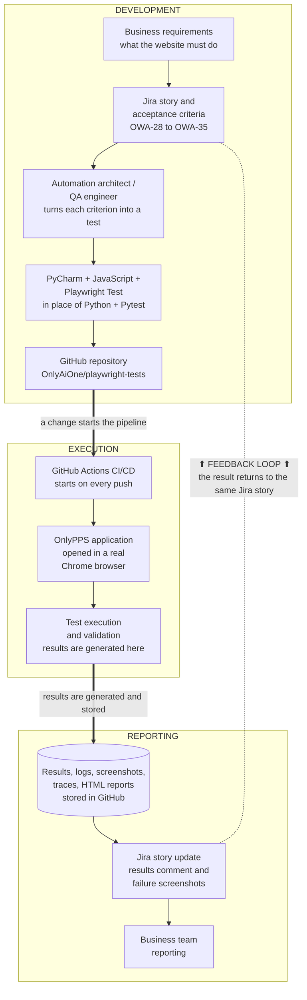
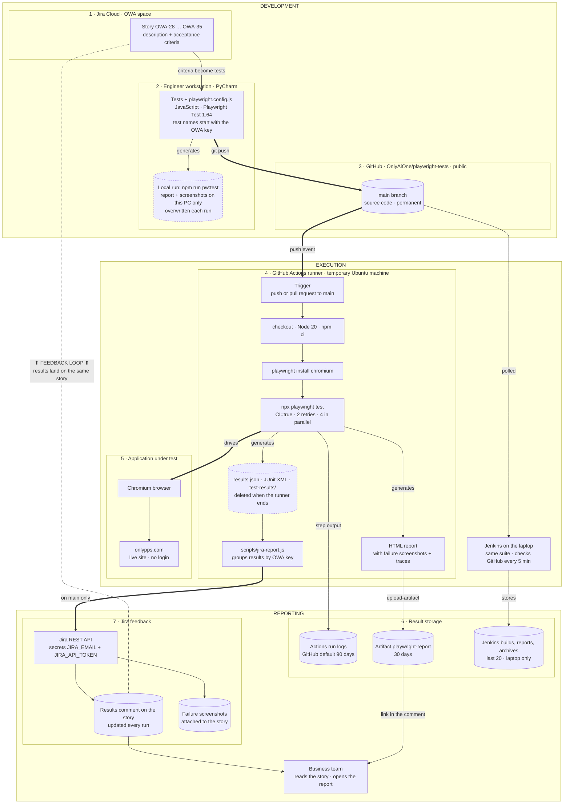

# Automation Architecture

How the onlypps.com test automation works end to end, from a business need written in Jira to proof that the website behaves as expected. There are two views: a business view for stakeholders and a technical view for the team. Both follow the same seven layers.

## Business view

What happens, in which order, grouped into development, execution and reporting. The dotted line is the feedback loop: every result returns to the Jira story it came from.

## Technical view

The real components in each of the seven layers. Arrows marked "generates" show where results are created; cylinders show where results are stored, and dashed cylinders are temporary (deleted when the CI runner ends, or overwritten on the next local run).

Planned items (pull requests and code review, page objects, choosing which stories to run) are not drawn. Their status is in the table below.

## The seven layers

| # | Layer | What it does | In place today | Partial or planned |
|---|---|---|---|---|
| 1 | Business and test management | The need is written in Jira as epic OWA-27 with 8 stories and acceptance criteria. | Epic, stories, criteria, 34 scenarios | Choosing which stories to run (planned) |
| 2 | Automation development | Scenarios become Playwright tests, written in PyCharm. | JavaScript + Playwright Test, `playwright.config.js` | Test data lives inside test files (partial); page objects and helpers (planned) |
| 3 | Source code management | All test code is versioned in GitHub. | Repository, `main` branch | Feature branch, pull request, code review (planned) |
| 4 | CI/CD execution | Every push starts a clean run: install, run, collect, report. | GitHub Actions and Jenkins, retries and failure evidence | Environments: production only (partial) |
| 5 | Application testing | A real Chrome browser uses the live site as a visitor would. | Navigation, business journeys, assertions | Login: not applicable on the public site |
| 6 | Reporting and evidence | Each run leaves a summary, failure details, screenshots, an HTML report and logs. | Summary, failures, screenshots, HTML report, CI logs | Traces only on CI retries (partial) |
| 7 | Jira integration | Results are matched to stories by the key in each test name, and the pipeline posts them to each story. | Traceability, status per story key, `scripts/jira-report.js` in GitHub Actions | Story comment and failure screenshots are built but run as a dry run until the Jira secrets are added (partial); reading a story and running only its tests (planned) |

## Notes

- The framework is JavaScript (`@playwright/test`). Python and Pytest were considered, and the decision was to stay on JavaScript.
- Each test title starts with its Jira story key, for example `OWA-31: fills the contact form with sample data`. That key is the link between a test result and its story.
- The contact form is filled but never submitted; requests that would send it are blocked.
